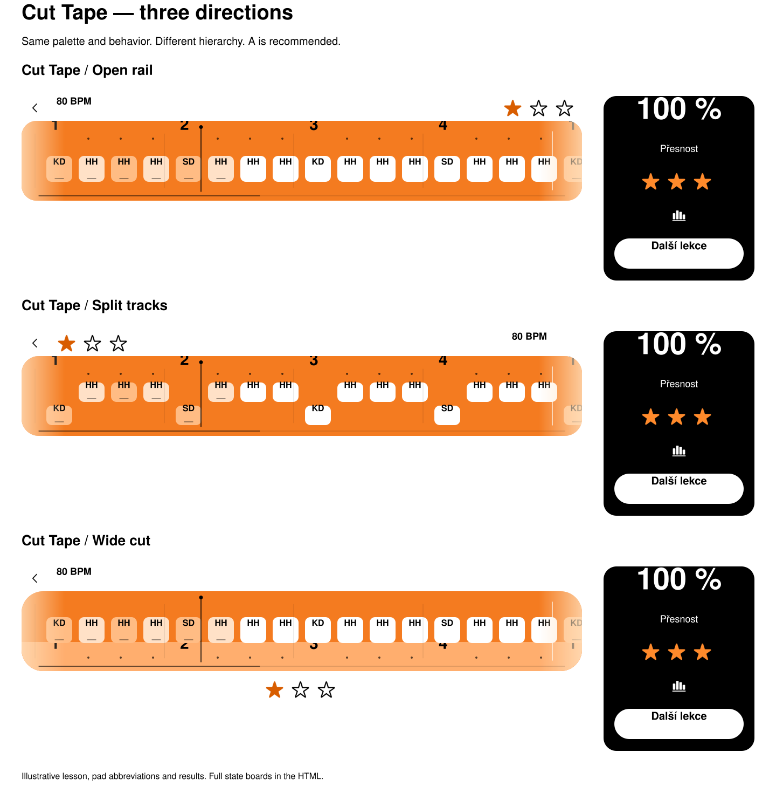

# Practice band, stars, and Detail — three Cut Tape proposals

Date: 2026-11-02. Status: design review only; no variant selected and no application changes authorized.

**Delivery limitation:** the native PNG export omitted text in two export attempts. Export work stopped under the repository's two-failure rule. Incorrect PNG boards are excluded. The standalone HTML and SVG boards are delivered; the requested PNG boards remain outstanding. The HTML was not opened or inspected in a browser, in accordance with the task's restriction on browser steps. These are proposals, not verified application screenshots.

[Open the standalone HTML](2026-11-02-band-proposals/index.html). It includes all three variants, light/dark appearances, seven states per variant, a motion toggle, star-rule interaction, signal examples, and accuracy layout examples. It needs no server, network, package installation, or application build.

## Recommendation

Choose **A — Open rail**. Large beat numbers and one row of tiles make the next hit easy to find while playing an external controller. The rounded orange tape remains the main visual element; the star group recedes above it. A horizontal result panel puts accuracy first and the next action at the far right. This keeps the Cut Tape identity without adding a second reading path.

B helps separate instrumental roles but requires scanning two tracks. C gives the beat numbers a distinct lower rail but puts more information near the position line and uses more vertical space for the stars. A has the clearest hierarchy for continuous practice.

## The three variants

All measurements below are logical points at the illustrated component size. The boards are component crops, not a proposed replacement of the whole practice screen. The small back arrow and tempo are context for icon weight and placement; the application source was not read to reconstruct the existing toolbar.

| Variant | Band | Stars during ready/play/count-in | Result composition | Tradeoff |
| --- | --- | --- | --- | --- |
| **A · Open rail** | 148 pt high, 28 pt radius; numbers above one hit lane | Upper right, aligned with the context toolbar | Accuracy and its caption left; stars and Detail in the middle; next action right | Recommended: one visual path through the pattern |
| **B · Split tracks** | 148 pt high, 32 pt radius; upper hi-hat and lower kick/snare tracks | Upper left, next to the back control; tempo right | Slightly larger accuracy figure; stars/Detail grouped centrally; next action right | Separates roles but increases eye travel; track assignment is a proposal, not an existing app fact |
| **C · Wide cut** | 148 pt high, 40 pt radius; tiles above a lighter orange beat rail | Centered immediately below the band | Accuracy, caption, and stars form a vertical group; action and Detail sit to its right | More spacious; uses more height and gives the lower edge more visual work |

| Variant | Light: all seven states | Dark: all seven states |
| --- | --- | --- |
| A | [Open light board](2026-11-02-band-proposals/a-light.svg) | [Open dark board](2026-11-02-band-proposals/a-dark.svg) |
| B | [Open light board](2026-11-02-band-proposals/b-light.svg) | [Open dark board](2026-11-02-band-proposals/b-dark.svg) |
| C | [Open light board](2026-11-02-band-proposals/c-light.svg) | [Open dark board](2026-11-02-band-proposals/c-dark.svg) |

## Shared visual rules

The product's physical idea is a cut strip of rhythm passing under a fixed reading marker. No texture, decorative bevel, glass, neon, emoji, or unrelated accent color is added. Orange shades carry information; the hierarchy comes from size, spacing, and shape.

| Element | Proposal |
| --- | --- |
| Grounds and text outside the band | White/black in light mode, black/white in dark mode |
| Tape | Orange; illustrative tempo stops: `#FFA45D` at 60 BPM, `#F47B20` at 80 BPM, `#E96C10` at 110 BPM |
| Listen | A visibly lighter orange tape, illustrated as `#FFC18B` at 80 BPM |
| Unplayed hit | White rounded tile; black pad abbreviation |
| Played hit | The same tile with a pale orange feedback tint and a small lower mark; the original white-tile identity remains recognizable |
| Beat numbers | System font, semibold, 30 pt; actual beat data `1 2 3 4` |
| Subdivisions | Three 4 pt dots at equal sixteenth-note spacing; no `e`, `&`, or `a` text |
| Beat lines | 0.75 pt black at 19% opacity, subordinate to the numbers and tiles |
| Bar boundary | One 1.5 pt white separator, no bar label; the next `1` is a beat number, not a measure caption |
| Marker | Fixed 1.5 pt black line with a small 7 pt cap; the tape moves beneath it |
| Multi-bar position | One 1 pt line near the bottom edge, with a darker completed segment on the same line |
| Single-bar position | The entire lower position line is absent |

The tempo and Listen swatches specify the proposed visual range, not new tempo thresholds or playback behavior. Preserve the existing meanings and progression of those signals when implementing a selected variant. The band remains orange in both appearances; the surrounding text and controls invert.

The edge light is the sole local fade: warm orange/white light inside an approximately 80 pt edge region, clipped to the tape. It represents the existing speed/lag feedback. It does not radiate outside the band. Both edges are shown in the running review state so their appearance can be compared; this does not introduce a rule that they must light simultaneously. Preserve the app's existing side assignment, trigger, duration, and intensity behavior.

[Signal examples, light](2026-11-02-band-proposals/signals-light.svg) · [Signal examples, dark](2026-11-02-band-proposals/signals-dark.svg).

## Stars and Detail

Use three SF Symbols, `star.fill` for earned and `star` for unearned. The visible star is approximately 29 pt in a 44 × 44 pt allocation; centers are 48 pt apart. The entire group is 140 × 44 pt. There are no boxes, chips, visible labels, or separate backgrounds. Earned stars use orange (`#D85D00` on white; `#FF8A2B` on black); outlines use black or white. Filled versus outlined shapes communicate state without depending on color.

In A, place the group at the upper-right edge of the band in ready/play/count-in. After a run, show it only in the result panel, not twice. B and C use the positions in the comparison table. Keep the group's hit area clear of the moving tape and navigation controls.

Tap the star group or hold it for 500 ms to open the rules. A normal tap gives the same access without requiring discovery of the long press. This adds no extra icon to the minimal result panel. Accessible group text should include the count, for example `2 ze 3 hvězd. Pravidla hvězd`; make the decorative individual star images silent. The HTML rules dialog demonstrates the access pattern only. Its first-star copy is explicitly a placeholder; reuse the app's exact existing rules and thresholds after selection.

Detail uses only the **`chart.bar.xaxis` SF Symbol, 22 pt, Regular**, exported from the system symbol library. Its 48 × 48 pt hit area exceeds the required 44 × 44 pt minimum. Use the same Regular symbol rendering as the illustrated toolbar control; match the application's actual toolbar weight during an approved implementation. The accessible label is exactly **`Detail`**. It has no underline, visible text, badge, or enclosing box. In A/B it follows the stars; C places it at the result panel's trailing edge. The HTML uses the same accessible name and keyboard activation.

## State coverage

Every variant has the following seven rows in both appearances. Captions in the left margin describe the review state and are not part of the product.

| State | What the proposal shows |
| --- | --- |
| Ready | White tiles, numbers and subdivision dots, fixed marker, no edge light; one previously earned star |
| Playing | Orange-tinted played tiles plus white upcoming tiles; both edge treatments visible; fixed marker |
| Count-in | A single 112 pt numeral replaces the tile/grid content; HTML motion cycles `4 3 2 1` for demonstration |
| End with one star | Frozen tape, `87 %`, full `Přesnost` caption, one filled/two outlined stars, Detail, `Další lekce` |
| End with two stars | Frozen tape, `96 %`, full caption, two filled/one outlined star, Detail, `Z paměti o ★3` |
| End with three stars | Frozen tape, `100 %`, full caption, three filled stars, Detail, `Další lekce` |
| New star | The second star at the scale peak; same final layout and next action as the two-star state |

The percentages, previous star, two-bar pattern, pad abbreviations `KD/SD/HH`, and action availability are illustrative data. They do not define scoring thresholds, pad mappings, unlock conditions, or new navigation behavior. Keep the existing eligibility logic. No secondary scores, verdict text, trophies, explanations, or extra buttons appear inside the result panel.

## Accuracy must remain whole

Treat `100 %` as one indivisible value with tabular numerals. In an implementation, use a nonbreaking space or an indivisible value/unit view. Never wrap, ellipsize, clip, or solve a crowded row by shrinking the figure unexpectedly. Reserve the width of three digits plus the percent sign from the start, even while showing `87 %`.

At standard text size, A reserves a 260 pt accuracy block for a 64 pt figure and the complete 18 pt `Přesnost` caption underneath. The caption has its own full line. B's figure is 68 pt; C centers a 64 pt figure and the same complete caption.

At narrower widths, move the action onto the next full-width row before shrinking the accuracy block. The supplied proofs use **696 pt content width**, representing a 744 pt viewport with 24 pt margins. A/B keep the complete figure and caption on the left, stars/Detail on the right, and the action below. C stacks its value, caption, stars, and action. The 200% text proof gives A's 128 pt figure and 36 pt caption separate rows, then the stars/Detail row and the action. For still larger accessibility sizes, continue vertical stacking and let the panel grow; measure the complete strings rather than imposing a fixed height.

[Accuracy fit examples, light](2026-11-02-band-proposals/fit-light.svg) · [Accuracy fit examples, dark](2026-11-02-band-proposals/fit-dark.svg).

The SVG figures are single text elements and cannot line-wrap; no result-panel clip is applied. The fit examples are separately laid-out scenes with full-size type, not scaled-down copies of a landscape panel. They demonstrate the proposed layout, not behavior already implemented in the app.

## Motion contract

The content scrolls beneath the fixed marker. Retain the existing played-hit feedback across a loop boundary; never reset all tiles to white at once. Clear or fade feedback for an individual event when it is offscreen, maintaining identity across the seam. The HTML's periodic tape is a visual conveyor with frozen illustrative feedback repeated at the same seam; it is not a scoring or playback simulation and does not prescribe transport timing.

For a newly earned star, fill the existing outline in place, scale from approximately 0.86 through 1.08 to 1.00, and settle within about 480 ms. Only the newly earned star moves. No particle burst, halo, celebratory text, or panel reflow is introduced. The static award row freezes the peak. This refines appearance while retaining the existing star-award event and automatic-stop behavior; it does not award on every repeat or restart playback.

The HTML motion toggle runs the conveyor, count-in example, and a one-shot star animation. System Reduce Motion disables the conveyor and star scaling; the star stays filled. Numeric count-in changes remain readable without spatial movement. These are isolated review animations; application motion tokens and event timing are not changed.

## Review and remaining work

The native exports were visually inspected and rejected because of missing glyphs. After a second export failure, no further export attempts were made. No application source, project settings, tests, or existing design decisions were edited. No app tests or app build were run for this documentation-only task. The pre-existing working changes in application files belong to other work and are excluded from this task's commit.

The HTML contains embedded vector scenes and real system-symbol images; all required state/appearance combinations are present in its source. Browser interaction, rendering, real-iPad readability, and the requested complete PNG export remain unverified/outstanding. Choosing A/B/C is still Jakub's decision; none is approved for implementation.

`generate.py` is the standalone proposal generator. Its JSON scene files are temporary generation inputs and are not committed. The exported symbol PNGs are the only raster files included; they are not substitutes for the missing full proposal PNG boards. No image-generation model or stock imagery was used. The design-taste rules informed hierarchy and restraint; no skill scripts or browser workflow were run. The functional edge fade, large count-in/result figures, and orange palette follow the task's explicit requirements.
