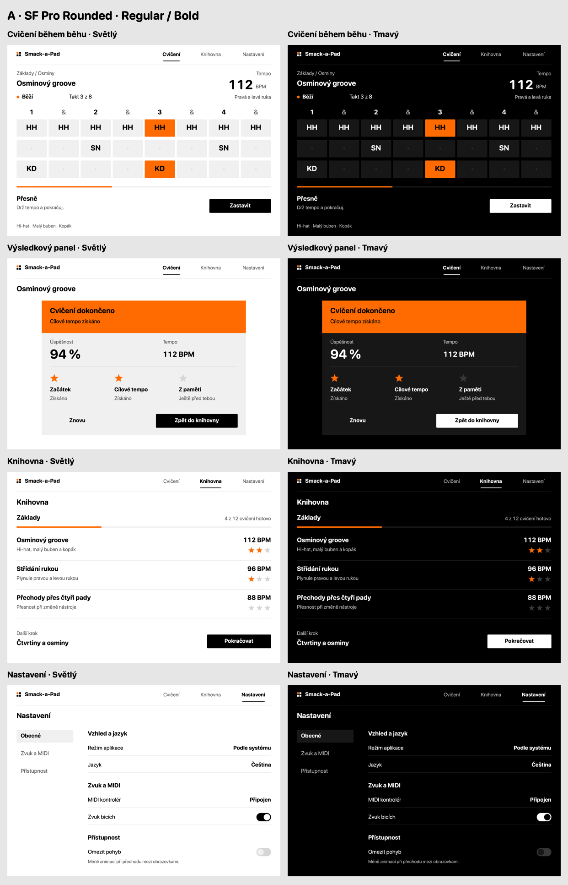
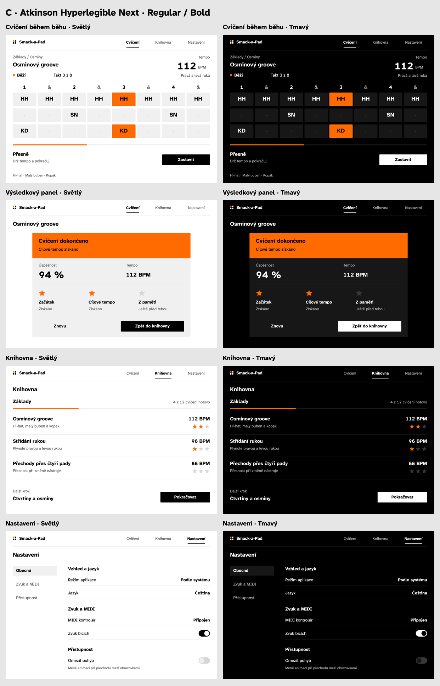
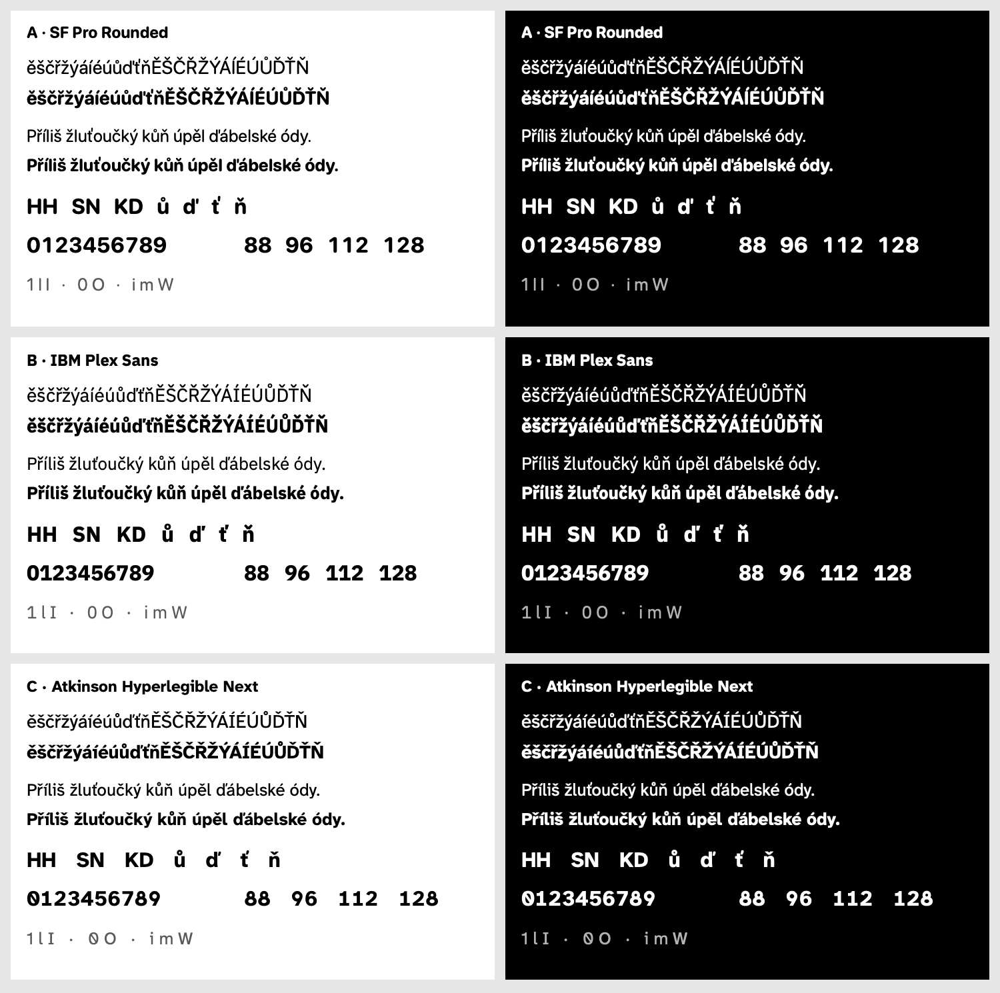

# Application typography proposals

Date: 2026-11-02 · Status: design proposals; selection pending

**Recommendation: B — IBM Plex Sans, Regular 400 and Bold 700.** It gives Smack-a-Pad the character of a musical instrument while keeping ordinary text proportional and comfortable to read. The other choices are A — SF Pro Rounded, for a softer native Apple appearance, and C — Atkinson Hyperlegible Next, for particularly distinctive letterforms.

No application source, resources, project settings or font registration were changed. The downloaded fonts are design references inside this documentation folder; they are not bundled into the application. The separate preview renderer is not an application implementation.

## Comparison method

The only application source inspected was `SmackAPad/Sources/UI/Theme.swift`. It currently specifies Avenir Next Heavy for display roles and Menlo Regular for text roles, with screen/section/row sizes of 28/22/18 pt and a 13 pt metadata role. The proposals replace that split with one family and a larger reading scale.

These are **comparison mockups, not screenshots of the running application**. The four compositions illustrate running practice, the result panel, the library and settings. Their content, geometry, sizes, weights, sample values and colours are identical between proposals; only the font changes. They do not propose new functionality, lesson data, scoring rules or a navigation redesign.

- Reference canvas: **1194 × 834 points**, landscape; individual PNGs: **2388 × 1668 pixels**, at 2×.
- Colours follow the inspected theme: white/black backgrounds, black/white ink, orange `#FF6B00`, light `#F0F0F0` and dark `#171717` surfaces. No gradient, glow, texture or decorative typography.
- One proportional family per proposal; **Regular 400 + Bold 700 only**. No italic, heavy, semibold or monospace face. A variable font file containing more weights does not mean those weights are used.
- Ordinary sentence case and normal spacing. Uppercase is retained only for actual abbreviations such as **HH, SN, KD, BPM and MIDI**. The all-capital Czech alphabet on the proof sheet is a glyph specimen, not an interface label.
- BPM, percentages and counters use tabular digits from the chosen family. Digits remain in one fixed weight while updating; surrounding letters remain proportional.
- Bold **32 pt** pad abbreviations are shown inside pattern cells, including the orange active cells. Shape and size remain stable during playback.

The 33 PNGs contain 24 individual screens, four direct comparison sheets, three family overview sheets, a Czech/numeral proof and an SF design study. Overview sheets reduce screens to 50% for comparison; they are not a way to judge physical reading distance.

## A — SF Pro Rounded

**One family/design: system SF Pro Rounded · Regular + Bold · standard width.**

Rounded terminals soften the utilitarian pattern grid and make the application more approachable. This is the most recognisably native option and needs no redistributed font files. The risk is a slightly playful character; the restrained two-weight scale prevents it from becoming a toy-like display treatment. This is a visual judgment based on the rendered specimens.

Apple documents SF Pro as the system font, including a rounded design, optical sizes and multiple widths. Use the operating system's font service in any later implementation; do not copy Apple's font binaries into the app. [Apple font information](https://developer.apple.com/fonts/)

**Rounded and Expanded were considered separately.** The main A mockups consistently use Rounded. The auxiliary study shows default, Rounded and the native Expanded width at the same 32 pt Bold size. Expanded consumes more horizontal space, particularly in Czech lesson titles and settings values; I would not make it the application's default. I would also avoid mixing Rounded body text with Expanded headings: keeping one consistent design makes this proposal clearer. The study is an investigation, not three additional proposals. [Apple Expanded width](https://developer.apple.com/documentation/appkit/nsfont/width/expanded)

[SF default / Rounded / Expanded study](2026-11-02-typography/previews/sf-design-study.png)

## B — IBM Plex Sans — recommended

**One family: IBM Plex Sans · Regular 400 + Bold 700 · normal width (100).**

Its firm shapes suit the pad grid and tempo readout, while its proportional text and curved letterforms make descriptions feel like interface copy. Bold pad abbreviations have a clear silhouette; Regular gives settings and lesson descriptions breathing room. This is my strongest balance between a recognisable product character and reading comfort. It is a design assessment, not a measured claim of superiority over the other families.

The tradeoff is a more technical character than Rounded. Use normal-width **Sans** throughout: neither Plex Mono nor Plex Sans Condensed belongs in this proposal. Avoid tracked labels, tiny metadata and excessive bold text, which could bring back the terminal-like impression even with a different family. IBM describes Plex Sans as intended to work in user interfaces. [IBM's font project](https://github.com/IBM/plex/)

The exact preview file is `IBMPlexSans[wdth,wght].ttf`, **version 3.201**, 537,244 bytes. It is licensed under **SIL OFL 1.1**, including permission to embed and redistribute it with software subject to its conditions. Keep its copyright and complete license with any future app distribution. The license reserves the name **Plex**; modified versions must respect that restriction. Application code does not become OFL merely by using the font. [License of the downloaded distribution](https://github.com/google/fonts/blob/main/ofl/ibmplexsans/OFL.txt)

## C — Atkinson Hyperlegible Next

**One family: Atkinson Hyperlegible Next · Regular 400 + Bold 700.**

This gives the interface a human, practical voice, with conspicuous differences between easily confused characters. Braille Institute developed the family around letter recognition and reading accessibility. The proof sheet makes its distinguishing numeral forms especially visible. That purpose does not by itself prove better reading at one metre for this application. [Braille Institute's family description](https://www.brailleinstitute.org/freefont/)

The tradeoff is that the unusual numeral shapes, including the slashed zero, can feel more diagnostic than musical. At the same nominal size its lowercase body is also slightly smaller than Plex in the inspected files; do not assume its accessibility-oriented name removes the need for a generous size. Choose **Next**, not **Atkinson Hyperlegible Mono**. The main mockups retain the same sizes as A and B for a fair comparison.

The exact preview file is `AtkinsonHyperlegibleNext[wght].ttf`, **version 2.001**, 114,552 bytes. It is licensed under **SIL OFL 1.1**, allowing embedding with software subject to its conditions. Keep the copyright and complete license with any future distribution. The inspected license does not declare a reserved font name. [License of the downloaded distribution](https://github.com/google/fonts/blob/main/ofl/atkinsonhyperlegiblenext/OFL.txt), [author project](https://github.com/googlefonts/atkinson-hyperlegible-next)

## Shared type scale for the whole application

All dimensions below are **logical points**, not exported PNG pixels. These are proposed baseline sizes; supporting larger accessibility text must not be implemented by shrinking labels back down to fit.

| Role | Size / intended line height | Weight | Usage |
| --- | --- | --- | --- |
| Live tempo / main result | 56 / 67 pt | Bold 700 | BPM value, main percentage; tabular digits |
| Screen title / pad abbreviation | 32 / 40 pt | Bold 700 | Main heading; HH, SN, KD in pattern cells |
| Lesson title / beat number / live verdict | 28 / 35 pt | Bold 700 | Library rows, strong feedback, numbered beats |
| Section heading | 26 / 33 pt | Bold 700 | Settings groups and subordinate sections |
| Main control / setting / live status | 24 / 30 pt | Regular or Bold | Bold for action labels, selected values and “Běží”; Regular for setting names |
| Navigation / explanation / value label | 22 / 29 pt | Regular or Bold | Regular descriptions; Bold only for active navigation |
| Supplementary information | 20 / 28 pt | Regular 400 | Nonessential instrument key and explanatory setting text |

Critical playing information is at least **28–32 pt**; tempo is **56 pt**. There are no 13 pt metadata strings or uppercase overlines. Explanations spanning several lines should use approximately 1.5× line height, ordinary tracking and space for Czech accents. No condensed face, artificial horizontal scaling, synthetic bold or automatic text shrinking.

Apply the selected family consistently to all later typography roles, including the theme's display/text and canvas equivalents, count-in numbers, practice feedback, result/stage labels, library rows, settings, dialogs and onboarding. Ordinary text should scale with the system text-size preference. Canvas notation must gain room or a suitable layout at larger sizes rather than clipping accents or reducing the pad labels. This is scope for a later implementation, not a claim that these uninspected screens have been audited.

## Czech and numeral verification

The actual downloaded font files were registered **only in the renderer process**. Native AppKit/CoreText produced the PNGs, rather than an image generator approximating letters. The system proposal uses the Mac's native SF Rounded; the final iPadOS system-font rendering is still device-dependent.

For **both selected weights of all three families**, the renderer checked:

1. Direct, nonzero glyph coverage for `ě š č ř ž ý á í é ú ů ď ť ň`, their uppercase equivalents, pad abbreviations and digits.
2. Shaped text for those Czech letters and “Příliš žluťoučký kůň úpěl ďábelské ódy.” in both composed and decomposed Unicode forms, without another font appearing in the text runs.
3. Equal shaped advances for all ten digits with tabular figures enabled, and unequal advances for `i`, `m` and `W` to confirm proportional ordinary text.
4. Single-line width fitting for the illustrated labels. **685 text placements** fit their allocated widths. The rendered overview/proof sheets were also visually inspected for accent clipping, overlap and visible fallback.

| Family | Missing requested Czech glyphs, Regular / Bold | Width of each digit at 32 pt, Regular / Bold | Lowercase x-height at 32 pt, Regular / Bold |
| --- | --- | --- | --- |
| SF Pro Rounded | 0 / 0 | 19.719 / 21.078 pt | 16.250 / 16.750 pt |
| IBM Plex Sans | 0 / 0 | 19.200 / 19.200 pt | 16.512 / 16.800 pt |
| Atkinson Hyperlegible Next | 0 / 0 | 20.224 / 20.224 pt | 15.872 / 15.872 pt |

The different SF digit widths between Regular and Bold are expected: each weight is internally tabular. Do not change weight during a tempo update. Font versions, resolved face names, variation values and individual advances are recorded in [the verification record](2026-11-02-typography/font-verification.json). Original download URLs, Git blob identifiers, file sizes and SHA-256 hashes are in [the source manifest](2026-11-02-typography/fonts/sources.json).

Measured text contrast for the mockups is 7.36:1 for black on the orange band, 7.00:1 for secondary text on white, 6.15:1 on the light surface, 10.02:1 for secondary text on black and 8.55:1 on the dark surface. The main black/white text contrast is 21:1. These are sRGB relative-luminance calculations for the colours used here, not a full application accessibility audit.

## Direct comparisons and full-resolution screens

Each comparison has A, B and C from left to right; light above dark. Each full-resolution file contains just one screen, without comparison labels or a device frame.

| Surface | Side-by-side PNG |
| --- | --- |
| Running practice | [Compare practice](2026-11-02-typography/previews/compare-practice.png) |
| Result panel | [Compare results](2026-11-02-typography/previews/compare-result.png) |
| Library | [Compare library](2026-11-02-typography/previews/compare-library.png) |
| Settings | [Compare settings](2026-11-02-typography/previews/compare-settings.png) |

| Family | Practice | Result panel | Library | Settings |
| --- | --- | --- | --- | --- |
| A — SF Pro Rounded | [Light](2026-11-02-typography/previews/a-sf-rounded-practice-light.png) · [Dark](2026-11-02-typography/previews/a-sf-rounded-practice-dark.png) | [Light](2026-11-02-typography/previews/a-sf-rounded-result-light.png) · [Dark](2026-11-02-typography/previews/a-sf-rounded-result-dark.png) | [Light](2026-11-02-typography/previews/a-sf-rounded-library-light.png) · [Dark](2026-11-02-typography/previews/a-sf-rounded-library-dark.png) | [Light](2026-11-02-typography/previews/a-sf-rounded-settings-light.png) · [Dark](2026-11-02-typography/previews/a-sf-rounded-settings-dark.png) |
| B — IBM Plex Sans | [Light](2026-11-02-typography/previews/b-ibm-plex-sans-practice-light.png) · [Dark](2026-11-02-typography/previews/b-ibm-plex-sans-practice-dark.png) | [Light](2026-11-02-typography/previews/b-ibm-plex-sans-result-light.png) · [Dark](2026-11-02-typography/previews/b-ibm-plex-sans-result-dark.png) | [Light](2026-11-02-typography/previews/b-ibm-plex-sans-library-light.png) · [Dark](2026-11-02-typography/previews/b-ibm-plex-sans-library-dark.png) | [Light](2026-11-02-typography/previews/b-ibm-plex-sans-settings-light.png) · [Dark](2026-11-02-typography/previews/b-ibm-plex-sans-settings-dark.png) |
| C — Atkinson Hyperlegible Next | [Light](2026-11-02-typography/previews/c-atkinson-next-practice-light.png) · [Dark](2026-11-02-typography/previews/c-atkinson-next-practice-dark.png) | [Light](2026-11-02-typography/previews/c-atkinson-next-result-light.png) · [Dark](2026-11-02-typography/previews/c-atkinson-next-result-dark.png) | [Light](2026-11-02-typography/previews/c-atkinson-next-library-light.png) · [Dark](2026-11-02-typography/previews/c-atkinson-next-library-dark.png) | [Light](2026-11-02-typography/previews/c-atkinson-next-settings-light.png) · [Dark](2026-11-02-typography/previews/c-atkinson-next-settings-dark.png) |

## Decision and remaining physical check

Choose **B — IBM Plex Sans** for the best fit with the app's musical-instrument character. Choose **A — SF Pro Rounded** if a softer native appearance and zero bundled font files matter more. Choose **C — Atkinson Hyperlegible Next** if the distinctive character shapes are the deciding factor after trying the full-size proof.

The larger critical text, bold pad abbreviations and high text contrast are designed for glancing at an iPad during play. **One-metre reading has not been physically verified.** A desktop PNG cannot establish that result for a particular iPad, eyesight, brightness or room lighting.

Before choosing, open each individual practice PNG full-screen on the iPad in landscape, fitted to the same display area. From about one metre, check whether HH/SN/KD, 112 BPM and the live verdict can be identified immediately in both appearances; then compare the result panel and library titles. Avoid judging this from a zoomed comparison sheet. If the pad text is too small at the real device scale, increase its size and available cell space before implementation. Later dynamic-text and portrait checks belong to the selected implementation.

No app build or application tests were run for this documentation task. Implementation remains pending Jakub's selection. Font licenses and complete binaries are retained only as documentation assets: [IBM license](2026-11-02-typography/fonts/ibmplexsans-OFL.txt), [Atkinson license](2026-11-02-typography/fonts/atkinsonhyperlegiblenext-OFL.txt). The [design-only renderer](2026-11-02-typography/render-previews.swift) makes the PNGs reproducible without opening or changing the application.
