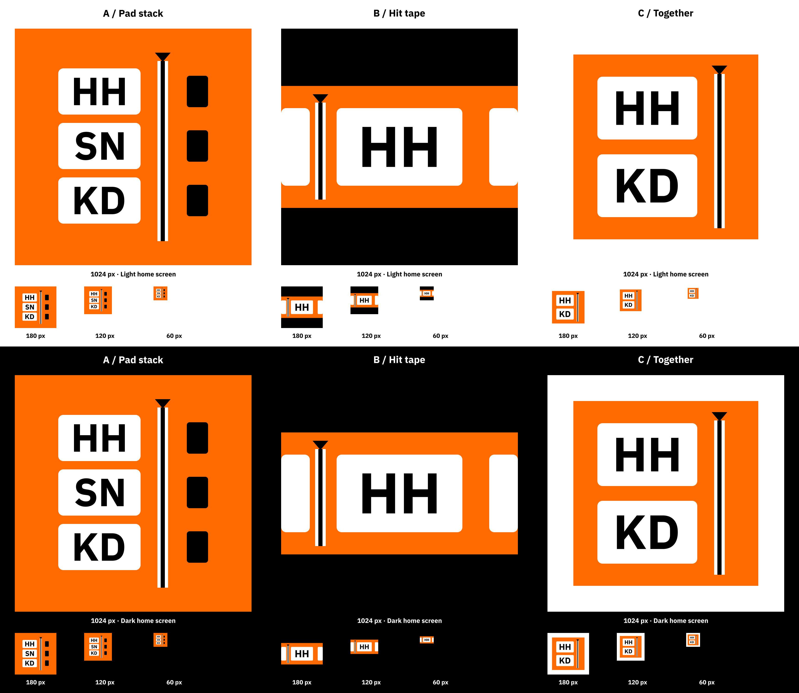

# Smack-a-Pad — icon and launch proposals

Design proposals for Ticket 45, 2026-11-03. Selection is pending Jakub's review. No application implementation or commit is part of this delivery.

**Recommendation: B / Hit tape.** Its horizontal orange silhouette reads as the app's scrolling notation rather than a generic pad bank. The enlarged HH is the simplest abbreviation to recognise at 60 px, and a fixed playhead gives the launch a clear connection to practice. A retains the full three-row vocabulary; C gives simultaneous hits a quieter, white-framed identity. These are design judgments; iPad recognition has not been physically verified.



## Review the proposals

Open any HTML file directly in a browser; no server, network, package installation or app build is required. Every preview embeds the SVG artwork, IBM Plex Sans font, CSS and JavaScript. The three links allow comparison when the files stay together.

| Concept | Icon export | Editable vector | Launch preview | Main tradeoff |
| --- | --- | --- | --- | --- |
| A / Pad stack | [1024 px PNG](a-stack.png) | [SVG](a-stack.svg) | [Open A](a-stack.html) | HH, SN and KD explicitly show three physical pad rows. The smallest abbreviation treatment of the three. |
| B / Hit tape | [1024 px PNG](b-tape.png) | [SVG](b-tape.svg) | [Open B](b-tape.html) | One oversized HH cell and cropped neighbouring cells read as continuous time. Only one pad abbreviation is represented. |
| C / Together | [1024 px PNG](c-together.png) | [SVG](c-together.svg) | [Open C](c-together.html) | HH and KD share a column to communicate a simultaneous hit. The white perimeter makes orange occupy less of the icon. |

The overview contains each icon at **1024, 180, 120 and 60 actual image pixels**, repeated on white and black home-screen background samples. View the overview at 100% to judge these sizes; a fitted viewer shrinks the whole sheet. Background samples are deliberately plain and are not iPad screenshots. The source icons are square, without an iPadOS corner mask; the operating system supplies that mask in a later implementation.

## Visual contract

- Exactly `#FF6B00` from `Theme.orange`, `#000000` and `#FFFFFF`. Raster edge antialiasing and animation opacity naturally produce intermediate pixels; no additional design colours, gradients, glow, textures or sound are used.
- IBM Plex Sans, normal width, Bold 700 for the exact wordmark **Smack-a-Pad** and pad abbreviations. Preview explanation text uses Regular 400. The SVGs contain glyph outlines, so their appearance does not depend on installed fonts.
- White hit cells, black pad abbreviations, an orange pattern band, and the black playhead with white clearance come from the inspected `PatternField.swift`. Icon proportions are deliberately simplified. No controller mapping, rhythm data, score or app layout changes are proposed.
- All PNGs are opaque 1024 × 1024 RGB images. SVGs have a full-canvas opaque base and remain editable as paths. No full wordmark is squeezed into the small app icons.

## Launch storyboards

Each preview has Replay, Light/Dark, Reduce Motion and an optional Loop preview switch. The launch surface accepts a tap to skip; the explicit Skip animation button supports keyboard use, and Escape also skips. Replays cancel the preceding animation and pending timers. Reduce Motion starts from the system preference and can be emulated independently with the switch. The demo contains no audio.

| Time | A / Pad stack | B / Hit tape | C / Together |
| --- | --- | --- | --- |
| 0–240 ms | Static first frame | Static first frame | Static first frame |
| 240–1000 ms | Playhead travels 80 icon units to its final position across fixed rows | Notation moves left by 90 icon units under a fixed playhead | 240–320 ms: hold; 320–960 ms: both aligned cells share one gentle opacity dip and return; 960–1000 ms: hold |
| 1000–1200 ms | Hold resolved mark and wordmark | Hold resolved mark and wordmark | Hold resolved mark and wordmark |
| 1200–1800 ms | Brand moves and scales into the Library header | Same handoff | Same handoff |
| 1420–1800 ms | Library content fades in underneath the arriving header | Same handoff | Same handoff |

**Total normal duration: 1.8 seconds.** Reduce Motion uses the identical initial composition, completely still for **800 ms**, then a **200 ms cross-fade** to the same final Library composition. It has no translation, scale or notation animation. Skip resolves immediately to the final composition, cancels running work and moves keyboard focus back to Replay when necessary.

### Exact first frame and handoff

The preview display is a 4:3 iPad surface. At frame zero, the brand group is centred at 50% of width and height. It is 60% of the screen width; its icon is 19% of the screen width, followed by a 3% gap and a 5%-of-screen-width Bold wordmark. The brand's centre is its layout-box centre. Its transform is `translate(-50%, -50%)`; the group has a top-left transform origin. There is no Library content yet.

| Appearance | Launch background | Wordmark | Icon |
| --- | --- | --- | --- |
| Light | Opaque white `#FFFFFF` | Black `#000000` | Exact chosen SVG geometry and colours |
| Dark | Opaque black `#000000` | White `#FFFFFF` | Same SVG; no recolouring |

The later static launch screen must use **this same composition, in the same safe-area coordinate space**, with the chosen pre-rendered icon and wordmark artwork, before SwiftUI presents the matching first frame. The page controls, Skip button and black device bezel are review tools, not part of that static screen. The dark preview has a thin white device-boundary guide, also excluded from the launch artwork. Share colour and geometry constants between launch artwork generation and SwiftUI so there is no white flash or font-layout jump. Portrait and other iPad ratios should keep the same centred relationship; their physical fit remains a later implementation check.

The normal handoff ends with the brand's unscaled layout origin at 5% of the screen width, 4% of the height, scaled to 0.5. Library starts at 22% of the screen height. Reduced motion cross-fades directly to that same header and list. The Library rows are **illustrative review content**, not a navigation redesign or authoritative lesson catalog.

### Feasible native implementation, in a separate ticket

SwiftUI needs only the chosen vector shapes or an image, the bundled Plex face, `opacity`, `offset`/position and `scaleEffect`. The playhead and notation can be drawn using `Canvas`. Use a single root launch phase owned by the app process, consume it once, and keep it consumed across scene background/foreground changes and window recreation. Do not start the sequence from a screen's repeated `onAppear`. Respect the system Reduce Motion setting, stop motion immediately if that setting changes, and cancel scheduled completion work when skipped. No Lottie, video or extra library is needed.

Prepare the Library before beginning the transition. If startup loading is slower than the concept, finish the wordmark sequence on its resolved still frame rather than showing a blank destination. The 1.8-second storyboard is a proposed presentation duration, not a measured startup-performance guarantee. Real cold starts, device appearance, safe areas and background return behavior belong to the later implementation and Jakub's iPad check.

## Sources, reproduction and review limits

Read-only references: `docs/design/DIRECTIONS.md`, `docs/design/2026-11-02-typography-proposals.md`, `docs/design/2026-11-02-band-proposals-v2.md`, `Theme.swift` and `PatternField.swift`. Project design-skill rules informed the flat surfaces, product-derived identity, equal margins and working review controls. Per AGENTS.md, none of that skill's scripts or browser steps were run.

From the repository root, reproduce the vector and raster exports, then the standalone previews:

```sh
swift -module-cache-path docs/design/2026-11-03-icon-and-launch/.module-cache docs/design/2026-11-03-icon-and-launch/render-icons.swift
python3 docs/design/2026-11-03-icon-and-launch/make-previews.py
```

The renderer reads only the project's bundled Plex font and writes into this directory. The preview generator embeds the same unmodified font binary. Its complete [SIL OFL 1.1 license and copyright](ibmplexsans-OFL.txt) are preserved here and embedded in each HTML file. All icon geometry is original code-drawn artwork; no external images or legacy code were copied.

PNG dimensions/opacity and exported SVG structure were checked; the overview was visually inspected. Embedded JavaScript syntax was checked. Browser playback and real-device legibility remain for review; no browser interaction validation, app build or app tests are claimed. No application files, asset catalogs, project settings or ticket status were changed by this delivery. The working copy already contained unrelated changes, which were left in place.

**Decision pending:** Jakub chooses A, B or C. The chosen asset-catalog icon, static launch screen and actual cold-start animation become a new implementation ticket. These deliverables remain uncommitted for review, as Ticket 45 requests.
