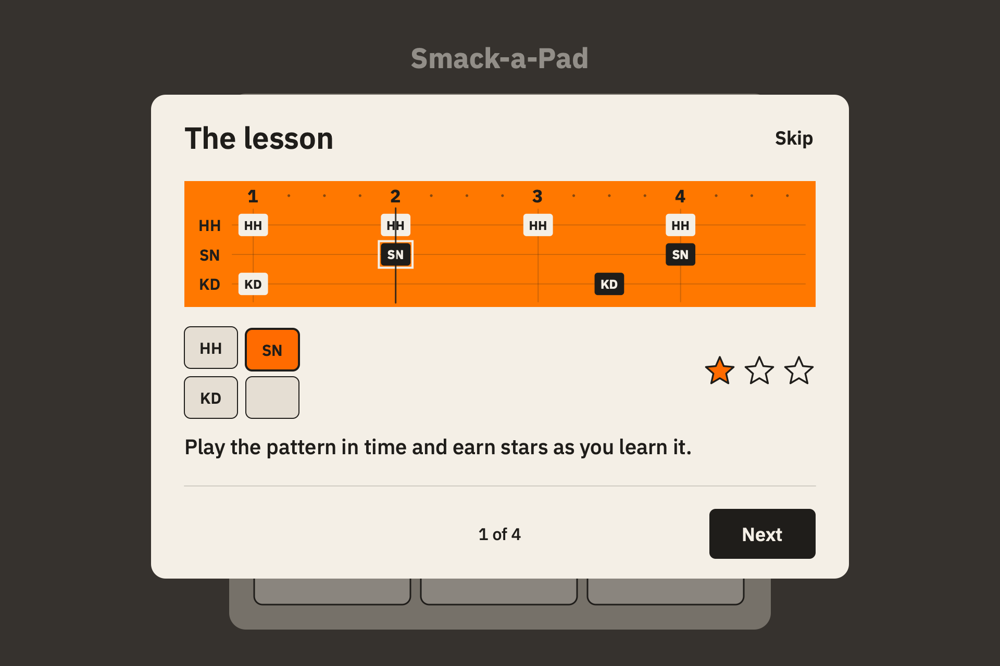
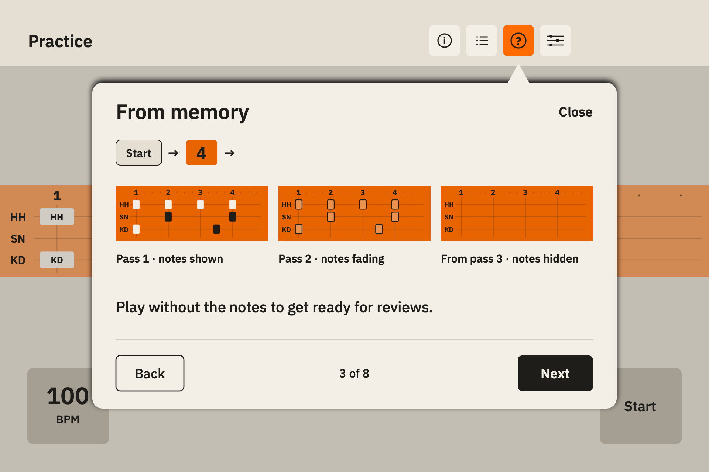
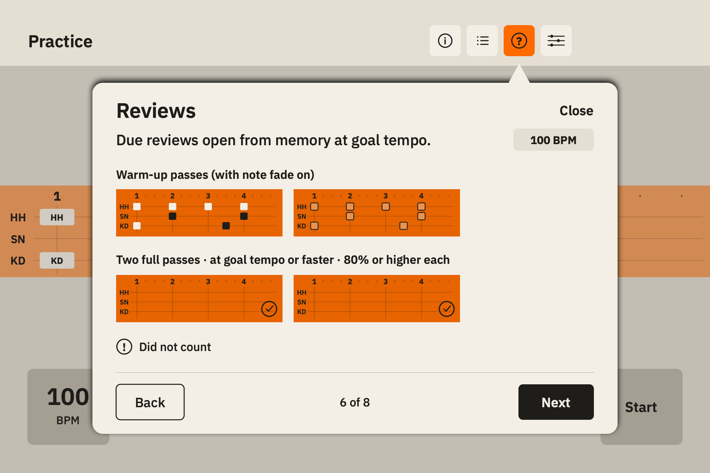

# How it works and first-launch tutorial

Jakub approved the Phase 1 design for [T159](../tickets/2026-11-09-159-help-and-first-launch-tutorial.md) on 2026-11-10. Implementation is tracked in [T162](../tickets/2026-11-10-162-implement-help-and-first-launch-tutorial.md). The card rules below follow the app's current behavior. The [November 8 action plan](../2026-11-08-ai-panel-action-plan.md) records the iPad check for T158.

## 1. Entry points

**Selected option A, a question mark beside Legend in Practice.** A player can open help where the question arises. A question mark has one meaning across Practice, Home and Settings. The Home row sits below the controller plate, leaving all nine pad positions in place. The Settings row is a button in the form. Both use the same title as the popover. In Practice, keep Lesson info and Legend in their current order and add a 48 pt Help target after Legend. If the group does not fit, wrap it onto a second line before reducing any target.

```text
A   Practice   [ⓘ] [Legend icon] [?] [Tools icon]
                                  └── How it works
    Home       [existing controller plate]
               [? How it works                 ›]
    Settings   [? How it works                 ›]

B   Practice   [ⓘ] [Legend icon] [Tools icon]
                 └── Lesson info
                     [How it works] ← first card
                     [Current lesson details]
    Home / Settings can link to the same help deck separately.

C   Practice   [ⓘ] [Legend icon] [Tools icon]
    Home       [? How it works                 ›]
    Settings   [? How it works                 ›]
```

| Option | Trade-off |
| --- | --- |
| A | Direct access from a lesson. Adds one target to the toolbar and two entry rows. |
| B | Fits the current toolbar. The player has to look inside lesson-specific information for app-wide rules. |
| C | Keeps the Practice toolbar as it is. The player has to leave the lesson for help. |

The existing `info.circle` buttons already identify [Lesson info](../../SmackAPad/Sources/UI/PracticeScreen.swift#L383) and [Intro Rules](../../SmackAPad/Sources/UI/IntroScreen.swift#L100). Reopen the same deck from every entrance, at the first card each time. On iPad use an anchored popover with an opaque surface. In a narrow window use a sheet with the same content and a pinned Close action. In Practice, opening help swaps out any open toolbar popover. A manually opened card can be read while the lesson runs. It stays silent and leaves the transport and MIDI input alone. Close or tap outside the popover to return to the practice controls.

## 2. First-launch tutorial

Four screens reuse help cards 1, 2, 3 and 4. Next advances, Back revisits the previous screen and Done closes the final screen. Skip stays in the header on all four screens, including at large text sizes. Reopening via **Watch tutorial** in the help deck starts at screen 1 and closes back to the card that opened it. The manual replay uses the same four screens inside the help presentation and leaves the lesson and its settings alone.

1. **Home is ready.** Wait for loaded progress and the initial Home reveal to finish. Before the Home pads accept input, show the tutorial only if the Home route is idle, progress loaded successfully, `hasAnyLessonProgress(progress.records)` is false and `@AppStorage("smackapad.tutorial.seen")` is false. Use the T157 predicate, which treats a started lesson or any earned star as progress. Saving a tempo alone does not count. Existing players can open help directly.
2. **Tutorial.** Set `smackapad.tutorial.seen` once the automatic presentation is actually visible. A later launch stays on Home even if the app was closed mid-tutorial. Skip, Done, a keyboard dismiss action and system dismissal all return to Home. Manual replay works independently of the flag, and a progress reset leaves this device-level flag in place.
3. **Intro pad.** Until the first presentation closes, suppress T157's light and accessibility emphasis. After dismissal, Home starts the existing `PadLightBar` on Intro if the profile is still empty. Reduce Motion keeps that light steady. A player may choose any Home pad.
4. **First practice screen.** When an eligible lesson with pad abbreviations has finished preparing and is stopped, T157 offers Legend under its existing guards. Opening help by hand takes precedence over the automatic Legend for that visit, as Lesson info already does. The legend flag stays unset until Legend is actually visible. Tutorial examples never create a practice session or consume `smackapad.legend.shownOnce`.

[T157 and its iPad result](../tickets/2026-11-09-157-first-run-and-legibility.md) · [Home's progress predicate](../../SmackAPad/Sources/UI/HomeScreen.swift#L3) · [Practice Legend guard](../../SmackAPad/Sources/UI/PracticeScreen.swift#L1109)

## 3. Help deck

Eight cards in this order. Show one at a time, with the topic and Close in the header and Back, Next and a position indicator in the footer. Show Watch tutorial in the footer on the first card. Done replaces Next on the last. The fixed chrome stays in view while the card body can scroll. Use 24 pt margins, 48 pt controls, the app's Plex Sans hierarchy and its white, black and orange roles. The pattern band is the main illustration. Use text beneath it for the one-line takeaway and use existing symbols or compact labels inside diagrams to carry the detail.

| Card | Visual | English caption | Czech caption |
| --- | --- | --- | --- |
| 1. The lesson | One measure from `PatternField` above a 2×2 crop of a pad layout. The playhead meets a note as the matching pad depresses. One filled star and two outlines close the example, using the lesson star glyphs. | Play the pattern in time and earn stars as you learn it. | Hraj přesně do rytmu a za pokrok získávej hvězdy. |
| 2. Listen and Play | Two labeled strips with the same measure. Listen shows the pattern sound and No score. Play shows the metronome and the filled star after a scored example. Render the app's `HardwareKeyButtonStyle` as static labels. Use the stock lesson settings in the example. | Play along in Listen, or play to the click for a score. | Při poslechu se můžeš přidat, při hře na klik získáš skóre. |
| 3. From memory | Show a stopped band under the existing Start label, the count-in numeral, then three stills labeled Pass 1, Pass 2 and From pass 3 using the strings below. Keep the measure and pad voices in the same place as the notes fade. If the active setting has fade off, replace the three stills with the count-in and a single hidden band labeled Notes hidden. | Play without the notes to get ready for reviews. | Hrou bez not se připravíš na opakování. |
| 4. Stars | Three compact rows pair the app's star outlines/fills with `StarRequirement` for stars 1 and 2, including the required run count, and the short spaced-review label for star 3. Illustrate different days with two separate review checkmarks. Use a fixed example for the tutorial or when there is no lesson context. The last row uses the two-star pair to point toward the next Path stage. | Enough two-star lessons open the next stage. | Další etapu otevře dostatek lekcí se dvěma hvězdami. |
| 5. Tempo | Draw the tempo display at rest with its adjustment controls, then a Play band with a clean pass and the existing tempo-up banner at the new BPM. Use a sample rise below the goal, then show the same goal value. | Set tempo while stopped, then clean passes raise it up to the goal. | Tempo nastavíš po zastavení, čisté průchody ho pak zvyšují až k cíli. |
| 6. Reviews | Start with the From memory icon and a goal BPM value. Show two groups of strips when fade is on, first the two warm-ups (visible and faded), then two successful hidden passes labeled with the full-pass and score requirement. With fade off show only the second group. Show the exclamation circle and Did not count underneath, separate from the example of a successful review. | Due reviews open from memory at goal tempo. | Opakování se otevře připravené ke hře zpaměti v cílovém tempu. |
| 7. Where to play | One five-row overview using existing destination labels. Pair each with one short line below. Use the Home and Training hierarchy, with Mix and Play after me grouped together. The diagram is read-only. | Five rows listed below. | Pět řádků uvedených níže. |
| 8. Ways to play | Three input silhouettes drawn from the app's pad and key shapes. Label them with Controller and calibration, Touch pads in portrait and Keyboard. Show the two hardware setup labels under Settings and the middle illustration with a 4×4 pad grid. | Use a MIDI controller, a hardware keyboard or portrait touch pads with a 16-pad layout. | Hraj na MIDI kontrolér, hardwarovou klávesnici nebo dotykové pady na výšku s rozložením 16 padů. |

Card 7 rows in display order:

| Existing label | English | Czech |
| --- | --- | --- |
| Today | Follow today's practice plan. | Projdi dnešní plán cvičení. |
| Training | See what is due for review. | Zjisti, které lekce čekají na opakování. |
| Library | Browse and choose lessons. | Procházej a vybírej lekce. |
| Mix | Play learned patterns back to back. | Zahraj naučené rytmy za sebou. |
| Play after me | App plays, you repeat. Without sheet music. | Aplikace zahraje, ty zopakuješ. Bez not. |

### Rule check and differences from the ticket

| Card | Source and verified behavior |
| --- | --- |
| 1 | [SPEC §§3.4, 3.8, 5.3](../SPEC.md#34-scoring) and [DECISIONS §6](../DECISIONS.md#6-scoring-carry-over-11-with-one-addition). Timing is scored against the pattern. Stars distinguish passing, mastery and retention. |
| 2 | [Pass audio and scorer](../../SmackAPad/Sources/UI/PracticeSession.swift#L212) and [Practice tools](../../SmackAPad/Sources/UI/PracticeScreen.swift#L1343). Listen plays the pattern and has no scorer. Play scores the player's hits, defaults to metronome on and pattern sound off, and allows changing both sound options. The illustration shows those defaults. |
| 3 | [Note visibility](../../SmackAPad/Sources/UI/PatternField.swift#L12), [memory setting](../../SmackAPad/Sources/UI/SettingsView.swift#L149), [SPEC §5.3](../SPEC.md#53-star-progression--practice-modes). The ticket compresses the transition after Start. With fade on, count-in precedes a visible first pass, a faded second and a hidden third. With fade off the running pattern is hidden from the start. Listen retains the pattern. The section-loop exception hides the notes while playing and does not qualify as a full lesson. From memory practice alone does not grant star 3. |
| 4 | [StarRequirement](../../SmackAPad/Sources/UI/StarRequirement.swift#L23), [SPEC §5.3](../SPEC.md#53-star-progression--practice-modes) and [DECISIONS §6](../DECISIONS.md#6-scoring-carry-over-11-with-one-addition). Star 1 normal threshold is 70%, or 80% for Intro. Learning also accepts at least 60% with at least 85% perfect/good hits and errors at most `max(1, floor(expectedHits × 0.10))`. Star 2 requires at least goal tempo with at most 0 errors for ≤15 hits, 1 for 16–32 and 2 above 32. Intro always allows 0. Stars 1 and 2 use `min(4, floor(15 / expectedHits) + 1)` qualifying runs, with at least 3 for Intro star 2. Learning accumulates runs and Challenge requires consecutive runs. A non-Intro example with eight expected hits needs two runs for each of stars 1 and 2. Star 3 comes from two successful spaced reviews on separate days. T158 allows qualifying reviews from the other entry routes too. |
| 4, Path | [SPEC §3.7](../SPEC.md#37-progression) and [DECISIONS §15](../DECISIONS.md#15-lesson-progression-guided-but-not-blocking). Two stars are enough **per qualifying lesson**. Automatic Path unlock needs `min(ceil(previous stage lesson count / 2), 10)` two-star lessons in the preceding stage. In 8-pad mode, lessons without a layout do not count. The graphic does not imply a single lesson automatically opens a stage. |
| 5 | [Practice tempo control](../../SmackAPad/Sources/UI/PracticeScreen.swift#L751), [SPEC §5.5](../SPEC.md#55-bpm-auto-progression), and [TempoUpBanner](../../SmackAPad/Sources/UI/TempoUpBanner.swift). Manual edits are for stopped practice. In continuous Play, a clean pass below goal queues a rise by 1, 2, 5 or 10 BPM, capped at goal, with a one-pass delay. The banner appears when the faster pass starts. Listen does not raise tempo automatically. Mix uses its own fixed lesson tempo. |
| 6 | [Review launch](../../SmackAPad/Sources/UI/AppNavigation.swift#L53), [Today launch](../../SmackAPad/Sources/UI/TodaySessionScreen.swift#L205), [Training launch](../../SmackAPad/Sources/UI/TrainingScreen.swift#L902), [ReviewScheduler](../../SmackAPad/Sources/Progression/ReviewScheduler.swift#L105) and [step marker](../../SmackAPad/Sources/Progression/TodayPlan.swift#L13). The preset applies when opening a due lesson from Today, Training, Library or Home. Two full passes from memory, at or above goal and at least 80% each, pass the review. Two eligible passes below 80% decide failure. Passes 1 and 2 are ignored when fade is on, so the earliest success is after four passes. With fade off the earliest success is after two. The ticket's estimate of about three runs with one or two qualifying does not match the scheduler. An exclamation means a played step did not count, including an unfinished or failed review. [T158 iPad result](../tickets/2026-11-09-158-review-from-library-and-uncounted-mark.md#test-result-jakub-ipad-2026-11-10) confirms the entry presets and marker. |
| 7 | [Today plan](../../SmackAPad/Sources/Progression/TodayPlan.swift#L97) combines available reviews, a new lesson and Mix. [Training](../../SmackAPad/Sources/UI/TrainingScreen.swift#L826) shows the review queue and also hosts [Mix](../../SmackAPad/Sources/UI/TrainingScreen.swift#L1104) and [Play after me](../../SmackAPad/Sources/UI/TrainingScreen.swift#L1193). Mix draws from learned lessons and runs them in sequence. In Play after me, the app plays and the player repeats without the pattern on screen. [SPEC §3.8](../SPEC.md#38-screens) defines Library browsing. |
| 8 | [SPEC §3.1](../SPEC.md#31-midi-input), [Settings](../../SmackAPad/Sources/UI/SettingsView.swift#L46), [keyboard setting](../../SmackAPad/Sources/UI/SettingsView.swift#L206) and [portrait-pad gate](../../SmackAPad/Sources/UI/PracticeScreen.swift#L72). The Practice touch grid requires portrait orientation, the option enabled and a 16-pad layout. Hardware keyboard mapping is available in Settings with a connected keyboard. |

## 4. New strings

English is the primary copy for this deck, as specified in T159. The app's existing language selector chooses which version is shown. The keys below are proposed identifiers for Phase 2. All other labels use the existing keys or native symbols. Use locale-aware numbers for tempo, percentages and the position value.

| Key | English | Czech |
| --- | --- | --- |
| `help.title` | How it works | Jak to funguje |
| `help.tutorial.reopen` | Watch tutorial | Zobrazit tutoriál |
| `help.nav.back` | Back | Zpět |
| `help.nav.position` | %lld of %lld | %lld z %lld |
| `help.goal.title` | The lesson | Lekce |
| `help.goal.caption` | Play the pattern in time and earn stars as you learn it. | Hraj přesně do rytmu a za pokrok získávej hvězdy. |
| `help.modes.title` | Listen and Play | Poslech a hra |
| `help.modes.caption` | Play along in Listen, or play to the click for a score. | Při poslechu se můžeš přidat, při hře na klik získáš skóre. |
| `help.modes.unscored` | No score | Bez skóre |
| `help.modes.scored` | Scored | Se skóre |
| `help.memory.caption` | Play without the notes to get ready for reviews. | Hrou bez not se připravíš na opakování. |
| `help.memory.hiddenFromThird` | From pass 3 · notes hidden | Od 3. průchodu · noty skryté |
| `help.memory.hidden` | Notes hidden | Noty skryté |
| `help.stars.reviews` | Pass two spaced reviews on different days | Splň dvě opakování v různých dnech |
| `help.stars.caption` | Enough two-star lessons open the next stage. | Další etapu otevře dostatek lekcí se dvěma hvězdami. |
| `help.tempo.caption` | Set tempo while stopped, then clean passes raise it up to the goal. | Tempo nastavíš po zastavení, čisté průchody ho pak zvyšují až k cíli. |
| `help.reviews.caption` | Due reviews open from memory at goal tempo. | Opakování se otevře připravené ke hře zpaměti v cílovém tempu. |
| `help.reviews.warmups` | Warm-up passes (with note fade on) | Rozehrávka (při zapnutém blednutí not) |
| `help.reviews.passes` | Two full passes · at goal tempo or faster · 80% or higher each | Dva celé průchody · cílové tempo nebo vyšší · každý alespoň 80 % |
| `help.overview.title` | Where to play | Kde hrát |
| `help.overview.today` | Follow today's practice plan. | Projdi dnešní plán cvičení. |
| `help.overview.training` | See what is due for review. | Zjisti, které lekce čekají na opakování. |
| `help.overview.library` | Browse and choose lessons. | Procházej a vybírej lekce. |
| `help.overview.mix` | Play learned patterns back to back. | Zahraj naučené rytmy za sebou. |
| `help.inputs.title` | Ways to play | Jak hrát |
| `help.inputs.caption` | Use a MIDI controller, a hardware keyboard or portrait touch pads with a 16-pad layout. | Hraj na MIDI kontrolér, hardwarovou klávesnici nebo dotykové pady na výšku s rozložením 16 padů. |

**26 new keys, each in two languages.** Reuse `Skip`, `Next`, `Done`, `Close`, `Start`, `Listen`, `Play`, `Pattern sound`, `Metronome`, `From memory`, the existing memory pass labels, `Stars`, the lesson's star requirement strings, `Tempo`, `Tempo up: %lld → %lld BPM`, `Goal tempo`, `Reviews`, `Did not count`, the five existing destination labels, the existing Play after me description and the input settings labels.

## 5. Reduce Motion and accessibility

Any movement plays once when the card appears and is cancelled when leaving it. The illustrations are silent. With Reduce Motion or VoiceOver enabled, use the same readable stills every time. Any text paired with a pictogram stays in the accessibility reading order, and only the drawn part is hidden. Focus enters at the topic heading, then moves through the example and caption to navigation. Announce the position using `help.nav.position` when the card changes. Keep Back, Next, Done, Skip and Close accessible by touch, keyboard and VoiceOver. Restore focus to the opener on close, or to Intro on Home when closing the automatic tutorial. Do not announce pass numbers or playhead positions as they animate.

| Card | Motion and still state | Accessible name or reading order |
| --- | --- | --- |
| 1. The lesson | Move the playhead over one hit, depress its pad and fill one star once. Still shows all three in their matched state. | Hide the drawing and read the title and `help.goal.caption` once. |
| 2. Listen and Play | Trace one measure once in each row. Keep both rows and their text side by side or stacked in the still. | Listen, Pattern sound, `help.modes.unscored`; Play, Metronome, `help.modes.scored`; then the caption. |
| 3. From memory | Keep the stages side by side or stacked. Emphasize them in order once, fading the middle notes only when enabled. Still shows the entire sequence, including the count-in. | Start, count-in numeral, existing localized Pass 1 and Pass 2 phase labels, `help.memory.hiddenFromThird`, then caption. With fade off read Start, count-in, `help.memory.hidden` and caption. Read the numeral as one static example, without ticks. |
| 4. Stars | Draw the three rows in place and fill stars once in order. Keep the requirements and two day marks visible in both modes. | Existing star names and requirement text in order, `help.stars.reviews` for the third, then `help.stars.caption`. Hide the duplicate icons. |
| 5. Tempo | Update the example value and show the banner once. Still shows both values and the banner as a static label. | Read Tempo, the existing localized banner label with both example values, and `help.tempo.caption`. Use the banner styling without its live announcement. |
| 6. Reviews | Static groups and markers. Use both the icon and label for Did not count. | `help.reviews.caption`, `help.reviews.warmups` if applicable, `help.reviews.passes` and the existing Did not count label. |
| 7. Where to play | Static rows. | Read each destination followed by its line. |
| 8. Ways to play | Static input illustrations. | Read the Settings group and each existing settings label, then `help.inputs.caption`. In Practice, the portrait grid also requires the existing Touch pads in portrait option to be enabled. |

At larger text sizes, stack the diagrams and let labels wrap. Keep the footer and dismiss action outside the scroll area. Use text and shapes for scoring states in both themes. Keep text ink on white or orange and white on black, with contrasting outlines for faded notes and unearned stars.

## 6. Reuse, new work and previews

| Reuse | Proposed work in Phase 2 |
| --- | --- |
| `Theme`, `PadPrimaryButtonStyle`, `PadSecondaryButtonStyle`, `HardwareKeyButtonStyle`, `PracticeIconButton`, Settings form row and existing popover styles | Help presentation with shared navigation, one card body per topic and the same card bodies in the four-screen tutorial. |
| `PatternField`, its note states and count-in, `PracticeTouchPadGrid` shapes, star glyphs used by `StarsView`, `StarRequirement`, `TempoUpBanner` styling and review step symbols | Static example inputs, an optional one-shot timeline and compact read-only diagrams. Use existing rendering with demo values where possible. Extract shared visual pieces if a current view also opens a popover, schedules a task or announces a live event. No practice/audio session is needed for any example. |
| Home load/reveal, `hasAnyLessonProgress`, `PadLightBar`, `PracticeScreen` legend gate and existing language path | Automatic presentation guard, device flag and manual replay, Home and Settings rows, Practice toolbar action, and both language files. |

Estimate **10 Phase 2 files** for option A. Three existing screens, three new Swift files for the presentation, illustrations and launch policy, two language files and two test files for the listed localization and launch checks. Allow one more source file if the live tempo banner or a pad view needs a shared read-only renderer.

The static mockups use the bundled IBM Plex Sans, orange `#FF6B00`, soft black `#1F1D1A` and cream white `#F4EFE6`, with the existing orange variations for the pattern band. Sample patterns and BPM values illustrate behavior.

### First-launch tutorial



### Practice help, From memory



### Practice help, Reviews



## 7. Decisions after approval

Jakub approved the design and delegated the remaining choices on 2026-11-10.

1. Use option A.
2. Keep four first-launch cards. Input setup stays in the help deck, where players can find it when they have their device to hand.
3. Keep the two-pass review diagram on Reviews and the two-day explanation on Stars. Verify the distinction with the manual iPad check.

### Manual iPad checks for Phase 2

- On a fresh profile, skip at each tutorial step. Confirm Home then highlights Intro and the first eligible stopped lesson offers Legend once. Relaunch after dismissing and after closing the app mid-tutorial. Try a profile with a started lesson and a profile with only a saved tempo.
- Reopen the tutorial from Help. Check that a stopped lesson stays stopped and that opening help during Play leaves the lesson and controller input running. Try landscape, portrait and a narrow window.
- Check English and Czech, large text, VoiceOver and Reduce Motion. On the review card, compare the example with note fade on and off and check that Did not count can be read independently of the icon.
